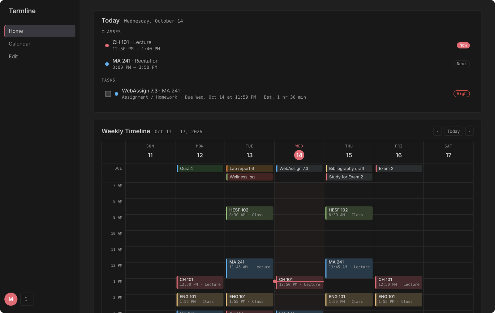
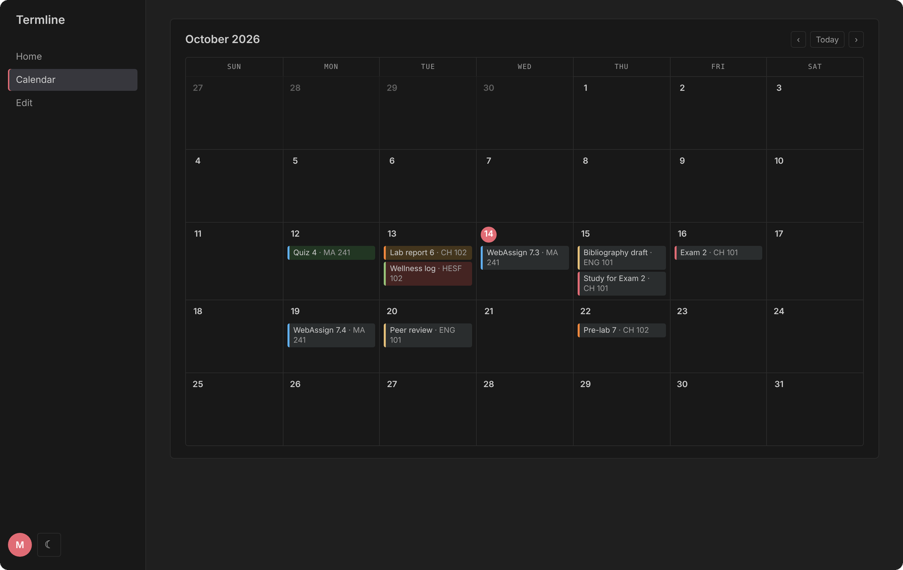
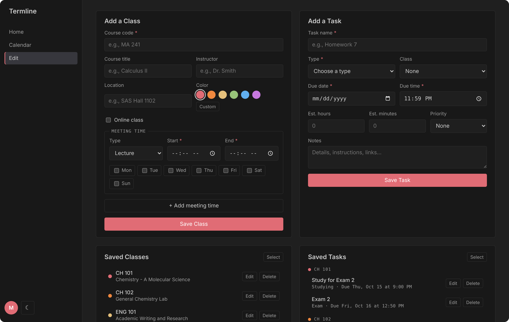
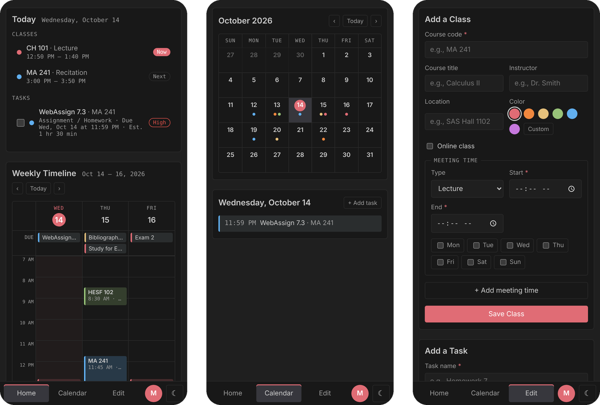
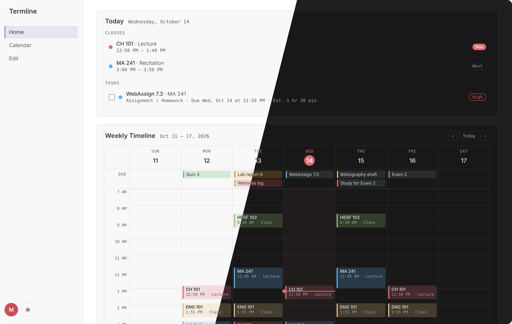

# Termline

**A student planner that puts your classes, assignments, and week on one timeline.**

**Live app:** [mxwander.github.io/termline](https://mxwander.github.io/termline/)

Termline lets students sign in, add their class schedule and assignments, and see everything in one place: what's happening today, a Google Calendar-style weekly timeline, and a 10-day to-do list. It works on a computer or as an iPhone home-screen app, and keeps working offline.

## Features

- **Today view:** today's classes with *Now* and *Next* tags, plus tasks due today
- **Weekly timeline:** color-coded class blocks, a row of due dates, and a live "now" line
- **Class details:** click any class to see its meeting times, location, instructor, and upcoming tasks
- **10-day to-do list:** overdue tasks first, then upcoming, then completed
- **Task status colors:** red for overdue, green for done on time, orange for done late
- **Monthly calendar:** every due date at a glance; click a day to add a task
- **Class and task editor:** multiple meeting times per class, online classes, six colors or a custom one, priorities, time estimates, and notes
- **Accounts:** email and password (with email verification) or Google sign-in; each person's data is private
- **Syncs across devices:** changes on a laptop show up on a phone right away
- **Works offline:** opens without internet and syncs changes once back online
- **Installable on iPhone:** Add to Home Screen for a full-screen app with its own icon
- **Light, dark, and auto themes**

## Screenshots

| Calendar | Edit |
|---|---|
|  |  |

**On iPhone**

**Light and dark themes**

## Built with / How it works

- **HTML, CSS, and JavaScript** with no framework or build step
- **Firebase Authentication** for sign-in (email and password, or Google)
- **Cloud Firestore** for storing each person's classes and tasks, with an offline copy on the device
- **Firestore security rules** ([firestore.rules](firestore.rules)) so each signed-in, verified user can only read and write their own data
- **Service worker** ([sw.js](sw.js)) that saves the app's files on the device so it opens without internet
- **Web app manifest** for installing on a phone's home screen
- **GitHub Pages** for hosting

Each user's data is stored at `users/{their id}/classes` and `users/{their id}/tasks`. Pages work with an in-memory copy of that data. When something changes, Termline works out exactly which items were added, edited, or deleted and sends only those changes to Firestore.

## What I learned

- Structuring a multi-page web app with plain JavaScript, and sharing code between pages
- Layout with CSS Grid and Flexbox, including a phone layout with a bottom tab bar
- Working with dates and times: week ranges, overdue logic, and placing class blocks on a timeline
- Adding user accounts, email verification, and per-user security rules with Firebase
- Keeping data in sync across devices, and making an app work offline with a service worker
- Debugging real problems: tracing a "saved but nothing saves" bug to a duplicate function, and working around a school Wi-Fi network that blocked Firebase's connection
- Using Git and GitHub to track changes and publish with GitHub Pages

## Run it yourself

1. **Get the code:** fork or clone this repository.
2. **Create a Firebase project** at [console.firebase.google.com](https://console.firebase.google.com) and add a **Web app** to it.
3. **Turn on sign-in:** in **Authentication → Sign-in method**, enable **Email/Password** and **Google**.
4. **Create the database:** in **Firestore Database**, create a database. On its **Rules** tab, paste the contents of [firestore.rules](firestore.rules) and click **Publish**.
5. **Connect your project:** replace the values in `firebase-config.js` with the config from your Firebase web app.
6. **Allow your website's address:** in **Authentication → Settings → Authorized domains**, add the domain you'll host on (for example `yourname.github.io`).
7. **Run it:** open the folder in VS Code and start it with the **Live Server** extension, or publish it with GitHub Pages.

The Firebase web config is meant to be public; the security rules are what keep each user's data private.

## Credits

Built step by step with guidance from Claude, an AI assistant. I made the design and feature decisions, put together and tested the code, and set up the hosting and database.